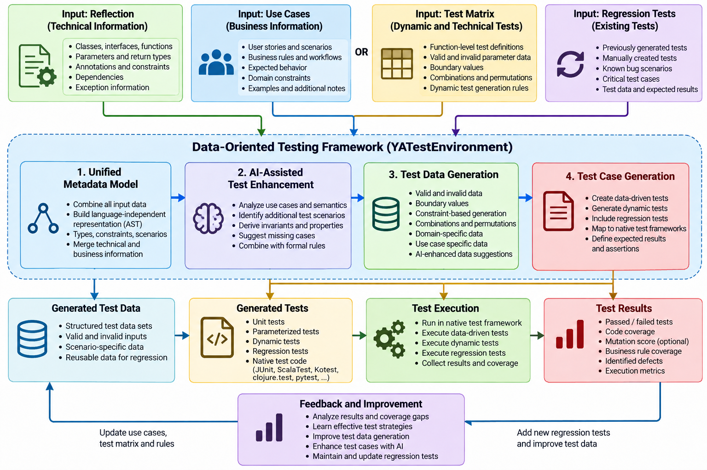

# `Data-oriented testing` ACTIVE-DATA/PRISMATIC SCHEMA/CLOJURE SPEC/TYPE HINTS and user-defined data. How they work together in the project 


First of all, please read the introduction by the creators:
[Introduction to Active Data](https://github.com/active-group/active-data/tree/main/doc/intro.md) and the definition of what a REALM is in active-data: [REALMS in active-data](https://github.com/active-group/active-data/tree/main/doc/realms.md). This is necessary to understand the following.

## Intention / Introduction

Here, `active-data` will be seen from the perspective of testing programs. In contrast to a data representation via a key-value map or pure dynamic typing, records, functions, and other types are strictly defined by `active-data` realms. As a result, the types and data structures are well defined and visible in the source code. There is no way to create a record or a function in a way that does not meet the requirements of the `active-data` realm definition. This is true for sets of a specific type, maps with specific key/value types, enums, records, and functions. This strict definition improves testability because a test framework can read the data's specific contracts and attributes. For example, a test can see whether an integer range or an enum is defined and which values are valid. You no longer need to test a function with every possible value to see whether unwanted values return a well-defined result. The result of an unwanted value is defined by active data. So testing can focus on the valid data range to verify the logic. Testing parameter and return-value validity is complex and time-consuming, and if you don't need to test it further, you have many other things to test.

What has to be tested for the incoming parameters is, for example, the relation of the values of a parameter in relation to the values of the other parameters given in the same call of a function. If `realm/intersection` and `realm/union` are used, possibly in connection with `realm/restricted`, such things can also be expressed with `active-data`.

To get input for tests, the `active-data` meta information can be retrieved from the data objects or functions. This can be used to get all information about the interfaces of functions, records, and other data objects.

Like Java reflection, we have all the information we need to create tests that cover all combinations needed for very high coverage. The same is valid when generating test data.

Since we talk about data-oriented programming and design, it is fair to call this `data-oriented testing`, because input data from reflection, user-defined contracts, and data layouts drive test definitions and test data generation. 

## What is `data-oriented testing` in YATestEnvironment

In short, `Data-oriented testing` is a testing approach in which tests and test data are defined and generated automatically by analyzing reflected productive functions and using user-defined use cases, data formats, data source definitions, and data flow plans. One part of the tests can be generated and executed dynamically, and the test results can be logged in detail. This part focuses on testing functionality with different kinds of test data. The other part includes tests that run strict checks on the production code for regression and new functionality. These tests store results to ensure repeatable, verifiable outcomes.

It's called `data-oriented` because it collects different kinds of data. The code treats reflection results as input data for testing and test data generation. Use cases are another data input, separating test assertions and test control flow from test data inputs and sources. The test code is generated so input data controls the flow, so the test code changes only if the business logic or general interfaces change. The tests and control flow are defined in a `Test Matrix` and a `Test Steps Definition`; together, these define the test logic and input data. 

In the following Clojure example, I show the principles of this testing approach. To see how it is realized effectively in the project, see the 
- [Design and Tech Documentation](./techdoc/designtech.html) .
### The principles are shown in a picture and in Clojure pseudo-code, without detailed function implementation.  

- Here is a workflow flowchart showing the intent:




- Here is the example in pseudo-code, stubbed Clojure:

```clojure

(ns yatest.data-oriented-testing)

(defn data-oriented-testing
  [configuration]

  ;; 1. Collect input information
  (let [reflection-data
        (reflect-source-code configuration)

        interface-definitions
        (if (has-interface-definitions? configuration)
          (load-interface-definitions configuration)
          (capture-runtime-interfaces configuration))

        business-use-cases
        (when (has-use-cases? configuration)
          (load-business-use-cases configuration))

        test-matrix
        (when (has-test-matrix? configuration)
          (load-dynamic-test-matrix configuration))

        regression-tests
        (load-existing-regression-tests configuration)

        ;; 2. Build unified semantic model
        unified-model
        (build-unified-reflection-model
          reflection-data
          interface-definitions)

        semantic-model
        (build-semantic-test-model
          unified-model
          business-use-cases
          test-matrix
          regression-tests)

        ;; 3. AI enhancement and formal validation
        semantic-model
        (if (ai-enabled? configuration)
          (-> semantic-model
              (enhance-test-scenarios-with-ai)
              (discover-missing-test-cases)
              (suggest-business-invariants))
          semantic-model)

        semantic-model
        (-> semantic-model
            (validate-test-constraints)
            (resolve-test-specifications))

        ;; 4. Generate test data
        test-data
        (-> (generate-valid-test-data semantic-model)
            (add-invalid-test-data semantic-model)
            (add-boundary-test-data semantic-model)
            (add-combinatorial-test-data semantic-model)
            (add-business-scenario-data semantic-model)
            (merge-regression-test-data regression-tests))

        ;; 5. Generate tests
        test-cases
        (-> (generate-unit-tests semantic-model test-data)
            (add-dynamic-tests test-matrix test-data)
            (add-business-use-case-tests
              business-use-cases test-data)
            (add-regression-tests regression-tests)
            (define-expected-results semantic-model)
            (validate-generated-tests))]

    ;; 6. Generate native test code
    (doseq [target (:test-targets configuration)]
      (let [native-tests
            (generate-native-test-code
              test-cases
              (:language target)
              (:test-framework target))]

        (save-generated-tests native-tests target)))

    ;; 7. Execute native tests
    (when (execution-enabled? configuration)
      (doseq [target (:test-targets configuration)]
        (let [results (execute-native-tests target)]
          (collect-test-results results)
          (collect-code-coverage results)
          (collect-business-rule-coverage results))))

    ;; 8. Analyze results and improve
    (let [analysis
          (when (execution-enabled? configuration)
            (analyze-test-results))

          gaps
          (when analysis
            (identify-coverage-gaps analysis))]

      (when analysis

        (when (has-failures? analysis)
          (record-defects analysis)
          (create-regression-candidates analysis))

        (when (has-coverage-gaps? gaps)
          (let [improved-model
                (improve-test-model
                  semantic-model analysis gaps)

                improved-model
                (if (ai-enabled? configuration)
                  (enhance-tests-with-feedback-ai
                    improved-model analysis)
                  improved-model)]

            (store-improved-test-model improved-model)))

        (update-regression-test-repository analysis)
        (store-test-generation-feedback analysis))

      ;; 9. Produce output
      (create-test-report
        test-cases
        test-data
        analysis))))

```

#### An overview of the logic

```text


INPUT
  |
  +-- Reflection
  +-- Interface definitions / Runtime capture
  +-- Business use cases
  +-- Dynamic test matrix
  +-- Existing regression tests
  |
  v
UNIFIED REFLECTION MODEL
  |
  v
SEMANTIC TEST MODEL
  |
  +-- AI-assisted enhancement (optional)
  +-- Constraint validation
  |
  v
TEST DATA GENERATION
  |
  +-- Valid / invalid
  +-- Boundary / combinations
  +-- Business scenarios
  +-- Regression data
  |
  v
TEST CASE GENERATION
  |
  +-- Unit tests
  +-- Dynamic tests
  +-- Business tests
  +-- Regression tests
  |
  v
NATIVE TEST CODE GENERATION
  |
  +-- JUnit / clojure.test
  +-- ScalaTest / Kotest / pytest
  |
  v
TEST EXECUTION (optional)
  |
  v
RESULTS AND COVERAGE ANALYSIS
  |
  +-- Failures -> Regression candidates
  |
  +-- Coverage gaps -> AI / Model improvement
  |
  +-- Feedback -> Next generation cycle
  |
  v
REPORT + PERSISTED IMPROVEMENTS

```

### The data driving tests and test-data generation

#### The input and workflow


